# Машинное обучение. Задание 1

## Подготовка данных: загрузка и визуализация, импутирование и интерполяция

**Выполнил:** Егор Пирогов
**Факультет:** социально-экономических и компьютерных наук
**Кафедра:** информационных технологий в бизнесе
**НИУ ВШЭ — Пермь, 2025**

---

### Набор данных

Используется **собственный набор данных** вместо предложенных преподавателем
(п. 1 дополнительной части, +1 балл).

| | |
|---|---|
| **Источник** | [Open-Meteo Archive API](https://open-meteo.com/en/docs/historical-weather-api) — реанализ **ERA5** (ECMWF) |
| **Объект** | г. Пермь, узел сетки 58.03° с.ш., 56.27° в.д., высота 150 м |
| **Период** | 01.01.2024 — 31.12.2024, часовой пояс Asia/Yekaterinburg (UTC+5) |
| **Дискретность** | 1 час → **8784 наблюдения** (2024 — високосный год: 366 × 24) |
| **Переменные** | температура на высоте 2 м, относительная влажность, приземное давление, скорость и направление ветра на 10 м, осадки |
| **Лицензия** | CC-BY 4.0, доступ без ключа |

Запрос к API и сохранение CSV вынесены в `scripts/download_data.py`,
поэтому ноутбук работает с локальным файлом и **не требует интернета**.

### Состав работы

| Пункт задания | Раздел ноутбука |
|---|---|
| 1. Скачать данные | 1 |
| 2. Загрузка, преобразование типов, 4 диаграммы | 2, 3 |
| 3. Качественный анализ предметной области | 4 |
| 4. Пять методов заполнения пропусков | 5 |
| 5. Недостоверные значения: 2σ/3σ, box-plot | 6 |
| Доп. часть: свой файл данных + лепестковая диаграмма | весь ноутбук, 7 |

**Целевая оценка: 9 баллов** = 8 (базовая часть) + 1 (свой набор данных и
дополнительный тип диаграммы).

### Импорт библиотек и настройка оформления


```python
import sys
import warnings
from pathlib import Path

import numpy as np
import pandas as pd
import matplotlib.pyplot as plt
import seaborn as sns
from scipy.interpolate import lagrange, CubicSpline

# Вспомогательные функции работы: оформление осей и методы импутации.
sys.path.insert(0, str(Path.cwd().parent / "scripts"))
from hw_utils import (
    style_axes, fill_prev3, lagrange_local, error_stats,
    sigma_outliers, iqr_outliers,
    MONTHS_SHORT, MONTHS_FULL, RUMBS_8, RUMBS_16,
)

DATA = Path.cwd().parent / "data" / "raw" / "perm_2024_hourly.csv"
FIG = Path.cwd().parent / "figures"
FIG.mkdir(exist_ok=True)

# Кириллица в подписях и корректный знак «минус» для отрицательных температур.
plt.rcParams["font.family"] = "DejaVu Sans"
plt.rcParams["axes.unicode_minus"] = False
plt.rcParams["figure.dpi"] = 110
plt.rcParams["savefig.dpi"] = 150
plt.rcParams["savefig.bbox"] = "tight"
plt.rcParams["figure.facecolor"] = "white"
sns.set_style("white")

np.random.seed(42)  # воспроизводимость
pd.set_option("display.precision", 3)

print("Проверка кириллицы: Пермь, температура −32.5 °C")
print("pandas", pd.__version__, "| numpy", np.__version__)
```

    Проверка кириллицы: Пермь, температура −32.5 °C
    pandas 3.0.5 | numpy 2.4.6


---
## 1. Исходные данные (пункт 1)

Файл скачивается один раз скриптом `scripts/download_data.py` и хранится в
репозитории работы, чтобы результат воспроизводился без обращения к сети.


```python
if not DATA.exists():
    raise FileNotFoundError(
        f"Не найден файл {DATA}.\n"
        "Выполните: .venv/bin/python scripts/download_data.py"
    )

print(f"Файл: {DATA.name}")
print(f"Размер: {DATA.stat().st_size / 1024:.1f} КБ")
print(f"Строк в файле: {sum(1 for _ in DATA.open())}")
print()
print("Первые строки файла как есть:")
print("".join(DATA.open(encoding="utf-8").readlines()[:5]))
```

    Файл: perm_2024_hourly.csv
    Размер: 387.0 КБ
    Строк в файле: 8788
    
    Первые строки файла как есть:
    latitude,longitude,elevation,utc_offset_seconds,timezone,timezone_abbreviation
    58.03163,56.27451,150.0,18000,Asia/Yekaterinburg,GMT+5
    
    time,temperature_2m (°C),relative_humidity_2m (%),surface_pressure (hPa),wind_speed_10m (m/s),wind_direction_10m (°),precipitation (mm)
    2024-01-01T00:00,-11.3,81,979.1,4.79,61,0.30
    


Структура CSV от Open-Meteo нестандартная: **первые три строки служебные**
(две строки метаданных о точке наблюдения и пустая строка-разделитель), и лишь
четвёртая строка содержит имена колонок. Поэтому при чтении указывается
`skiprows=3` — иначе pandas примет метаданные за заголовок и все столбцы
получат тип `object` вместо чисел.

---
## 2. Загрузка данных и преобразование типов (пункт 2)

### 2.1. Паспорт точки наблюдения


```python
meta = pd.read_csv(DATA, nrows=1)
print("Метаданные точки наблюдения:")
for col in meta.columns:
    print(f"  {col:24s} = {meta[col].iloc[0]}")
```

    Метаданные точки наблюдения:
      latitude                 = 58.03163
      longitude                = 56.27451
      elevation                = 150.0
      utc_offset_seconds       = 18000
      timezone                 = Asia/Yekaterinburg
      timezone_abbreviation    = GMT+5


### 2.2. Чтение таблицы наблюдений и приведение типов


```python
df = pd.read_csv(DATA, skiprows=3)
print("Исходные имена колонок (с единицами измерения):")
for c in df.columns:
    print("   ", c)

# Короткие имена для кода + отдельный словарь единиц для подписей осей.
df.columns = ["time", "temp", "humidity", "pressure",
              "wind_speed", "wind_dir", "precip"]

UNITS = {
    "temp": "Температура воздуха, °C",
    "humidity": "Относительная влажность, %",
    "pressure": "Приземное давление, гПа",
    "wind_speed": "Скорость ветра, м/с",
    "wind_dir": "Направление ветра, °",
    "precip": "Осадки, мм",
}

# Ключевое преобразование типов: строка -> datetime -> индекс временного ряда.
print("\nТип колонки time до преобразования:", df["time"].dtype)
df["time"] = pd.to_datetime(df["time"])
print("Тип колонки time после преобразования:", df["time"].dtype)

df = df.set_index("time").sort_index()

# Производные признаки для группировок и диаграмм.
df["month"] = df.index.month
df["hour"] = df.index.hour
df["doy"] = df.index.dayofyear
df["date"] = df.index.date

df.head()
```

    Исходные имена колонок (с единицами измерения):
        time
        temperature_2m (°C)
        relative_humidity_2m (%)
        surface_pressure (hPa)
        wind_speed_10m (m/s)
        wind_direction_10m (°)
        precipitation (mm)
    
    Тип колонки time до преобразования: str
    Тип колонки time после преобразования: datetime64[us]


<div>
<style scoped>
    .dataframe tbody tr th:only-of-type {
        vertical-align: middle;
    }

    .dataframe tbody tr th {
        vertical-align: top;
    }

    .dataframe thead th {
        text-align: right;
    }
</style>
<table border="1" class="dataframe">
  <thead>
    <tr style="text-align: right;">
      <th></th>
      <th>temp</th>
      <th>humidity</th>
      <th>pressure</th>
      <th>wind_speed</th>
      <th>wind_dir</th>
      <th>precip</th>
      <th>month</th>
      <th>hour</th>
      <th>doy</th>
      <th>date</th>
    </tr>
    <tr>
      <th>time</th>
      <th></th>
      <th></th>
      <th></th>
      <th></th>
      <th></th>
      <th></th>
      <th></th>
      <th></th>
      <th></th>
      <th></th>
    </tr>
  </thead>
  <tbody>
    <tr>
      <th>2024-01-01 00:00:00</th>
      <td>-11.3</td>
      <td>81</td>
      <td>979.1</td>
      <td>4.79</td>
      <td>61</td>
      <td>0.3</td>
      <td>1</td>
      <td>0</td>
      <td>1</td>
      <td>2024-01-01</td>
    </tr>
    <tr>
      <th>2024-01-01 01:00:00</th>
      <td>-10.7</td>
      <td>81</td>
      <td>978.1</td>
      <td>4.99</td>
      <td>57</td>
      <td>0.5</td>
      <td>1</td>
      <td>1</td>
      <td>1</td>
      <td>2024-01-01</td>
    </tr>
    <tr>
      <th>2024-01-01 02:00:00</th>
      <td>-10.5</td>
      <td>83</td>
      <td>977.0</td>
      <td>5.24</td>
      <td>55</td>
      <td>1.0</td>
      <td>1</td>
      <td>2</td>
      <td>1</td>
      <td>2024-01-01</td>
    </tr>
    <tr>
      <th>2024-01-01 03:00:00</th>
      <td>-10.4</td>
      <td>83</td>
      <td>976.4</td>
      <td>5.50</td>
      <td>53</td>
      <td>0.9</td>
      <td>1</td>
      <td>3</td>
      <td>1</td>
      <td>2024-01-01</td>
    </tr>
    <tr>
      <th>2024-01-01 04:00:00</th>
      <td>-10.5</td>
      <td>81</td>
      <td>976.1</td>
      <td>5.56</td>
      <td>52</td>
      <td>0.5</td>
      <td>1</td>
      <td>4</td>
      <td>1</td>
      <td>2024-01-01</td>
    </tr>
  </tbody>
</table>
</div>


### 2.3. Контроль качества данных


```python
print(f"Размерность таблицы: {df.shape[0]} наблюдений × {df.shape[1]} признаков")
print(f"Период: {df.index.min()} — {df.index.max()}")
print(f"366 суток × 24 часа = {366 * 24} (2024 — високосный год)")

print("\nПропуски по столбцам:")
print(df[list(UNITS)].isna().sum().to_string())

full_range = pd.date_range(df.index.min(), df.index.max(), freq="h")
missing_stamps = full_range.difference(df.index)
print(f"\nПропущенных отметок времени в сетке: {len(missing_stamps)}")
print(f"Ряд регулярный и непрерывный: {missing_stamps.empty}")

print("\nОписательные статистики:")
df[list(UNITS)].describe().T
```

    Размерность таблицы: 8784 наблюдений × 10 признаков
    Период: 2024-01-01 00:00:00 — 2024-12-31 23:00:00
    366 суток × 24 часа = 8784 (2024 — високосный год)
    
    Пропуски по столбцам:
    temp          0
    humidity      0
    pressure      0
    wind_speed    0
    wind_dir      0
    precip        0
    
    Пропущенных отметок времени в сетке: 0
    Ряд регулярный и непрерывный: True
    
    Описательные статистики:


<div>
<style scoped>
    .dataframe tbody tr th:only-of-type {
        vertical-align: middle;
    }

    .dataframe tbody tr th {
        vertical-align: top;
    }

    .dataframe thead th {
        text-align: right;
    }
</style>
<table border="1" class="dataframe">
  <thead>
    <tr style="text-align: right;">
      <th></th>
      <th>count</th>
      <th>mean</th>
      <th>std</th>
      <th>min</th>
      <th>25%</th>
      <th>50%</th>
      <th>75%</th>
      <th>max</th>
    </tr>
  </thead>
  <tbody>
    <tr>
      <th>temp</th>
      <td>8784.0</td>
      <td>3.440</td>
      <td>12.125</td>
      <td>-32.5</td>
      <td>-4.800</td>
      <td>2.7</td>
      <td>13.50</td>
      <td>30.90</td>
    </tr>
    <tr>
      <th>humidity</th>
      <td>8784.0</td>
      <td>77.224</td>
      <td>15.206</td>
      <td>23.0</td>
      <td>68.000</td>
      <td>81.0</td>
      <td>89.00</td>
      <td>100.00</td>
    </tr>
    <tr>
      <th>pressure</th>
      <td>8784.0</td>
      <td>996.738</td>
      <td>11.622</td>
      <td>953.1</td>
      <td>988.875</td>
      <td>997.1</td>
      <td>1005.10</td>
      <td>1031.40</td>
    </tr>
    <tr>
      <th>wind_speed</th>
      <td>8784.0</td>
      <td>3.128</td>
      <td>1.364</td>
      <td>0.0</td>
      <td>2.120</td>
      <td>3.0</td>
      <td>4.03</td>
      <td>9.45</td>
    </tr>
    <tr>
      <th>wind_dir</th>
      <td>8784.0</td>
      <td>201.597</td>
      <td>91.804</td>
      <td>1.0</td>
      <td>145.000</td>
      <td>222.0</td>
      <td>259.00</td>
      <td>360.00</td>
    </tr>
    <tr>
      <th>precip</th>
      <td>8784.0</td>
      <td>0.076</td>
      <td>0.366</td>
      <td>0.0</td>
      <td>0.000</td>
      <td>0.0</td>
      <td>0.00</td>
      <td>10.40</td>
    </tr>
  </tbody>
</table>
</div>


**Важное следствие для пункта 4.** В наборе данных **нет ни одного пропуска**:
ERA5 — это реанализ, то есть результат работы модели, усваивающей наблюдения,
и он по построению даёт полное поле без лакун. Поэтому пропуски в пункте 4
создаются **искусственно**, прореживанием заведомо известного участка ряда.
Это даёт важное методическое преимущество: удалённые значения нам известны
точно, и качество каждого метода восстановления можно измерить, сравнив
оценку с настоящим значением.

---
## 3. Обязательные виды диаграмм (пункт 2)

Требования методички, выполняемые на каждой диаграмме:

* **не менее 1000 значений** — используется весь годовой ряд, 8784 наблюдения
  (число указано в заголовке каждого графика);
* **подписаны оси** — с указанием единиц измерения, на русском языке;
* **указано направление изменения** — стрелки на концах осей (аналог `arrows()`
  из примеров на R);
* **построены клетки** — основная и вспомогательная сетка.

Единое оформление вынесено в функцию `style_axes()` (модуль `scripts/hw_utils.py`).

### 3.1. Линейная диаграмма — годовой ход температуры


```python
fig, ax = plt.subplots(figsize=(13, 5))

ax.plot(df.index, df["temp"], lw=0.35, color="tab:blue",
        alpha=0.75, label="Почасовые значения")
ax.plot(df.index, df["temp"].rolling(24 * 7, center=True).mean(),
        lw=2.2, color="darkred", label="Скользящее среднее за 7 суток")
ax.axhline(0, color="grey", ls="--", lw=1, label="0 °C")

style_axes(ax, "Месяц 2024 года", UNITS["temp"],
           f"Годовой ход температуры воздуха, Пермь, 2024 (n = {len(df)} наблюдений)")

ax.set_xticks([pd.Timestamp(2024, m, 1) for m in range(1, 13)])
ax.set_xticklabels(MONTHS_SHORT)
ax.legend(loc="upper left", framealpha=0.9)

fig.savefig(FIG / "01_line_temperature.png")
plt.show()
```


    
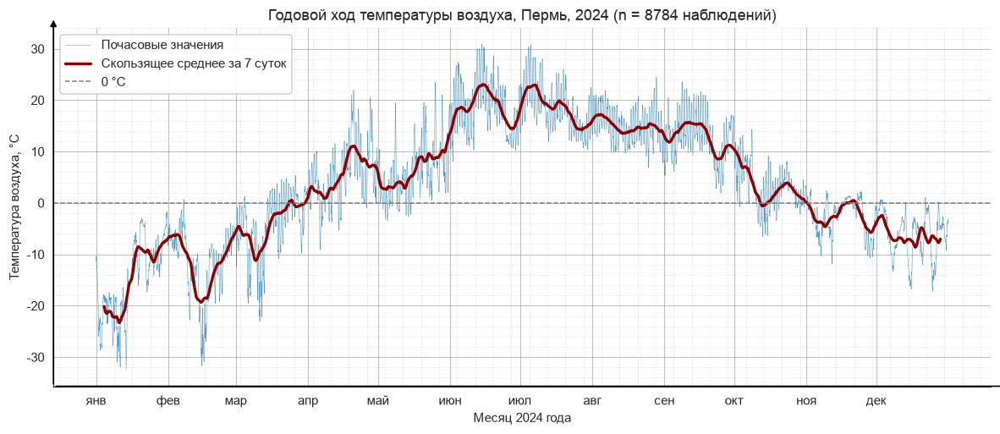
    


Ряд ведёт себя так, как и должен вести себя годовой ход температуры в умеренных
широтах: холодная половина года в начале и конце, тёплая — в середине. Тонкая
линия почасовых значений образует «облако» вокруг сглаженной кривой, и ширина
этого облака зимой заметно больше, чем летом.

Для демонстрации внутрисуточной структуры, которая на годовом масштабе
неразличима, ниже показан увеличенный фрагмент.


```python
july = df.loc["2024-07-01":"2024-07-31", "temp"]

fig, ax = plt.subplots(figsize=(13, 4))
ax.plot(july.index, july.values, lw=1.1, color="tab:red", marker=".", ms=2.5)

style_axes(ax, "Дата (июль 2024)", UNITS["temp"],
           f"Фрагмент ряда: суточный ход температуры, июль 2024 (n = {len(july)})")
fig.autofmt_xdate()

fig.savefig(FIG / "01b_line_july_zoom.png")
plt.show()

print(f"На фрагменте {len(july)} значений — вспомогательный график;")
print("требование «не менее 1000 значений» закрыто основной диаграммой (8784).")
```


    
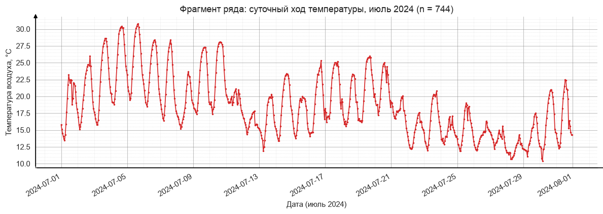
    


    На фрагменте 744 значений — вспомогательный график;
    требование «не менее 1000 значений» закрыто основной диаграммой (8784).


### 3.2. Столбчатая диаграмма — месячные суммы осадков и средняя температура


```python
monthly_precip = df["precip"].resample("ME").sum()
monthly_temp = df["temp"].resample("ME").mean()

fig, axes = plt.subplots(1, 2, figsize=(14, 4.6))

bars = axes[0].bar(range(1, 13), monthly_precip.values,
                   color="tab:blue", edgecolor="black", lw=0.6)
axes[0].bar_label(bars, fmt="%.0f", fontsize=8, padding=2)
style_axes(axes[0], "Месяц", "Сумма осадков, мм",
           f"Месячные суммы осадков (по n = {len(df)} часовым значениям)",
           grid_axis="y")
axes[0].set_xticks(range(1, 13))
axes[0].set_xticklabels(MONTHS_SHORT)

colors = np.where(monthly_temp.values < 0, "tab:blue", "tab:red")
bars2 = axes[1].bar(range(1, 13), monthly_temp.values,
                    color=colors, edgecolor="black", lw=0.6)
axes[1].bar_label(bars2, fmt="%.1f", fontsize=8, padding=2)
axes[1].axhline(0, color="black", lw=1)
style_axes(axes[1], "Месяц", UNITS["temp"],
           "Средняя месячная температура", grid_axis="y")
axes[1].set_xticks(range(1, 13))
axes[1].set_xticklabels(MONTHS_SHORT)

fig.tight_layout()
fig.savefig(FIG / "02_bar_monthly.png")
plt.show()

print("Годовая сумма осадков: %.0f мм" % monthly_precip.sum())
```


    
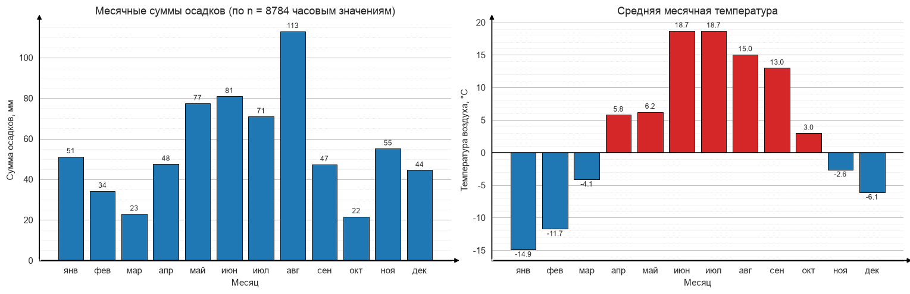
    


    Годовая сумма осадков: 666 мм


### 3.3. Круговая диаграмма — повторяемость направлений ветра по 8 румбам


```python
# Сектор «север» охватывает 337.5°..22.5°, поэтому шкала сдвигается на полсектора.
shifted = (df["wind_dir"] + 22.5) % 360
sector = pd.cut(shifted, bins=np.arange(0, 361, 45),
                labels=RUMBS_8, right=False, include_lowest=True)
counts = sector.value_counts().reindex(RUMBS_8)

fig, ax = plt.subplots(figsize=(7, 7))
ax.pie(counts.values, labels=RUMBS_8, autopct="%1.1f%%",
       startangle=90, counterclock=False,
       colors=plt.cm.tab20(np.linspace(0, 1, 8)),
       wedgeprops=dict(edgecolor="white", lw=1.4),
       textprops=dict(fontsize=11))
ax.set_title(f"Повторяемость направлений ветра по румбам,\nПермь, 2024 "
             f"(n = {len(df)} наблюдений)")
ax.axis("equal")

fig.savefig(FIG / "03_pie_wind_sectors.png")
plt.show()

print("Повторяемость по румбам, %:")
print((counts / counts.sum() * 100).round(1).to_string())
```


    
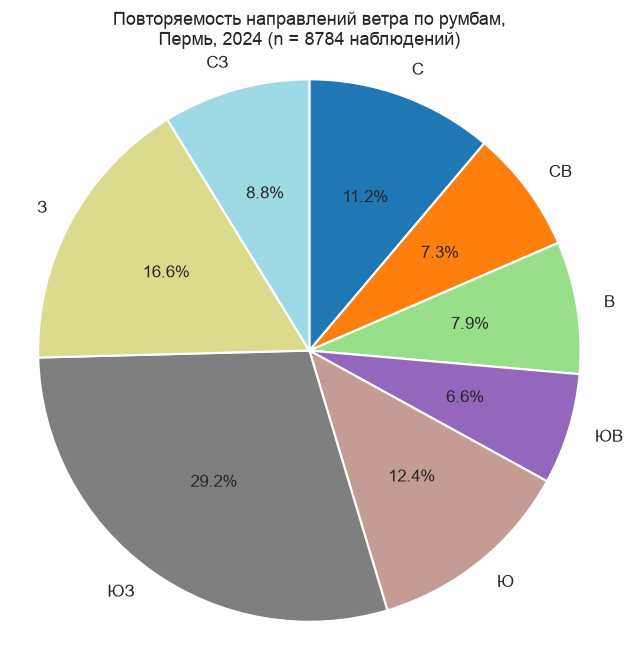
    


    Повторяемость по румбам, %:
    wind_dir
    С     11.2
    СВ     7.3
    В      7.9
    ЮВ     6.6
    Ю     12.4
    ЮЗ    29.2
    З     16.6
    СЗ     8.8


Для круговой диаграммы подписи осей, сетка и стрелки направления неприменимы:
у неё нет декартовых осей, а доли секторов подписаны непосредственно на
диаграмме в процентах. Требование методички об оформлении осей относится к
линейным и столбчатым диаграммам.

### 3.4. Скрипичная диаграмма — распределение температуры по месяцам


```python
fig, axes = plt.subplots(2, 1, figsize=(13, 9))

sns.violinplot(data=df, x="month", y="temp", inner="box",
               cut=0, density_norm="width", hue="month",
               palette="coolwarm", legend=False, ax=axes[0])
style_axes(axes[0], "Месяц", UNITS["temp"],
           f"Распределение температуры по месяцам (n = {len(df)} наблюдений)",
           grid_axis="y")
axes[0].set_xticks(range(12))
axes[0].set_xticklabels(MONTHS_SHORT)
axes[0].axhline(0, color="grey", ls="--", lw=1)

season = {12: "Зима", 1: "Зима", 2: "Зима", 3: "Весна", 4: "Весна", 5: "Весна",
          6: "Лето", 7: "Лето", 8: "Лето", 9: "Осень", 10: "Осень", 11: "Осень"}
df["season"] = df["month"].map(season)
order = ["Зима", "Весна", "Лето", "Осень"]

sns.violinplot(data=df, x="season", y="humidity", order=order, inner="box",
               cut=0, density_norm="width", hue="season", palette="Blues",
               legend=False, ax=axes[1])
style_axes(axes[1], "Сезон", UNITS["humidity"],
           "Распределение относительной влажности по сезонам", grid_axis="y")

fig.tight_layout()
fig.savefig(FIG / "04_violin_temp_humidity.png")
plt.show()
```


    
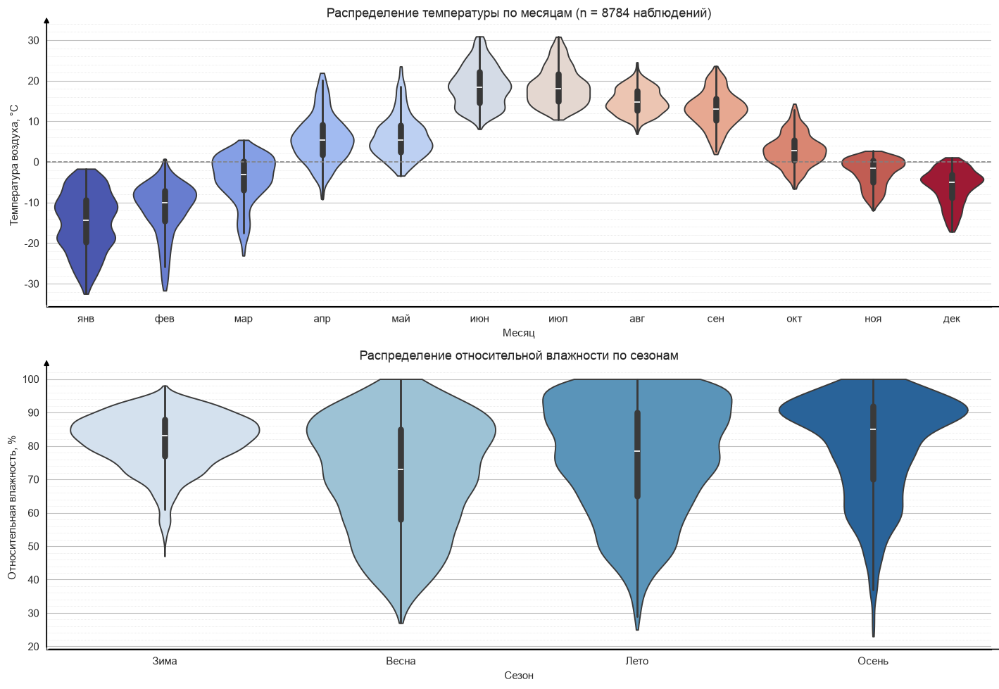
    


Скрипичная диаграмма показывает не только медиану и квартили (как box-plot),
но и **форму распределения**. Хорошо видно, что зимние месяцы дают широкие и
часто двугорбые «скрипки», а летние — узкие и компактные. Содержательная
интерпретация этого факта — в следующем разделе.

---
## 4. Качественный анализ предметной области (пункт 3)

Предметная область — **приземная метеорология умеренных широт**, точка
наблюдения расположена в Предуралье (г. Пермь). Ниже проверяются зависимости,
которые теория предсказывает для такого климата, и каждое утверждение
подкрепляется числом, рассчитанным по данным.

### 4.1. Суточный ход температуры


```python
hourly = df.groupby("hour")["temp"].mean()
summer_h = df[df["month"].isin([6, 7, 8])].groupby("hour")["temp"].mean()
winter_h = df[df["month"].isin([12, 1, 2])].groupby("hour")["temp"].mean()

fig, ax = plt.subplots(figsize=(11, 4.8))
ax.plot(hourly.index, hourly.values, lw=2.4, color="black", marker="o",
        ms=4, label="Весь год")
ax.plot(summer_h.index, summer_h.values, lw=1.8, color="tab:red",
        marker="^", ms=4, label="Лето (VI–VIII)")
ax.plot(winter_h.index, winter_h.values, lw=1.8, color="tab:blue",
        marker="v", ms=4, label="Зима (XII–II)")

style_axes(ax, "Час суток (местное время, UTC+5)", UNITS["temp"],
           f"Средний суточный ход температуры (n = {len(df)} наблюдений)")
ax.set_xticks(range(0, 24, 2))
ax.legend()

fig.savefig(FIG / "05_daily_cycle.png")
plt.show()

print(f"Минимум среднего суточного хода: {hourly.idxmin()} ч ({hourly.min():.1f} °C)")
print(f"Максимум среднего суточного хода: {hourly.idxmax()} ч ({hourly.max():.1f} °C)")
print(f"Амплитуда суточного хода летом: {summer_h.max() - summer_h.min():.1f} °C")
print(f"Амплитуда суточного хода зимой: {winter_h.max() - winter_h.min():.1f} °C")
```


    
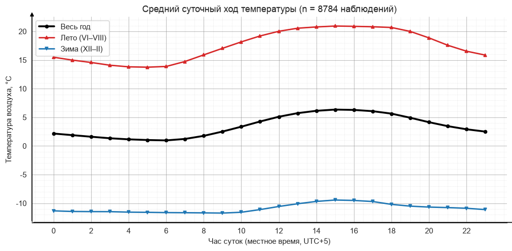
    


    Минимум среднего суточного хода: 6 ч (1.0 °C)
    Максимум среднего суточного хода: 15 ч (6.4 °C)
    Амплитуда суточного хода летом: 7.2 °C
    Амплитуда суточного хода зимой: 2.3 °C


### 4.2. Связи между метеорологическими величинами


```python
corr = df[list(UNITS)[:-1]].corr()

fig, ax = plt.subplots(figsize=(7.2, 5.6))
sns.heatmap(corr, annot=True, fmt=".2f", cmap="RdBu_r", center=0,
            vmin=-1, vmax=1, linewidths=0.6, linecolor="white",
            cbar_kws={"label": "Коэффициент корреляции Пирсона"}, ax=ax)
ax.set_title("Корреляционная матрица метеовеличин")
labels = ["Температура", "Влажность", "Давление", "Скорость ветра", "Направление"]
ax.set_xticklabels(labels, rotation=30, ha="right")
ax.set_yticklabels(labels, rotation=0)

fig.savefig(FIG / "06_corr_matrix.png")
plt.show()

print(f"Корреляция температура ↔ влажность (весь ряд): {corr.loc['temp', 'humidity']:.3f}")
print(f"Корреляция осадки ↔ изменение давления: "
      f"{df['precip'].corr(df['pressure'].diff()):.3f}")

monthly_stats = df.groupby("month")[["temp", "humidity", "pressure"]].mean()
monthly_stats.index = MONTHS_FULL
print("\nСредние по месяцам:")
monthly_stats.round(1)
```


    
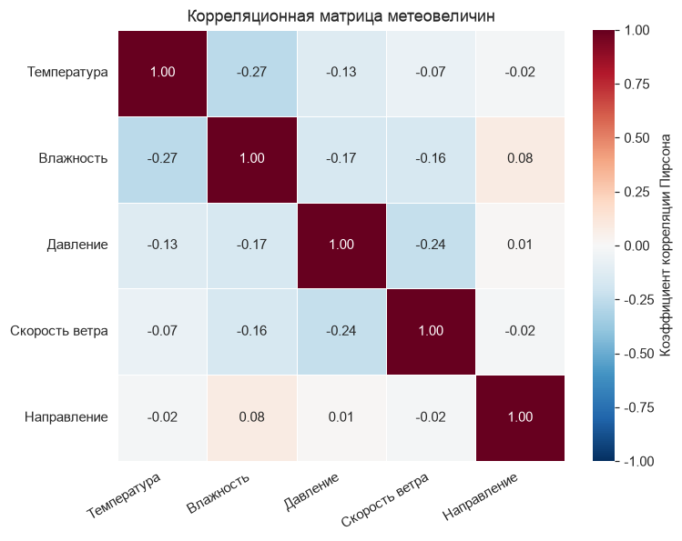
    


    Корреляция температура ↔ влажность (весь ряд): -0.269
    Корреляция осадки ↔ изменение давления: -0.085
    
    Средние по месяцам:


<div>
<style scoped>
    .dataframe tbody tr th:only-of-type {
        vertical-align: middle;
    }

    .dataframe tbody tr th {
        vertical-align: top;
    }

    .dataframe thead th {
        text-align: right;
    }
</style>
<table border="1" class="dataframe">
  <thead>
    <tr style="text-align: right;">
      <th></th>
      <th>temp</th>
      <th>humidity</th>
      <th>pressure</th>
    </tr>
  </thead>
  <tbody>
    <tr>
      <th>январь</th>
      <td>-14.9</td>
      <td>78.9</td>
      <td>994.5</td>
    </tr>
    <tr>
      <th>февраль</th>
      <td>-11.7</td>
      <td>77.8</td>
      <td>1001.1</td>
    </tr>
    <tr>
      <th>март</th>
      <td>-4.1</td>
      <td>78.6</td>
      <td>997.9</td>
    </tr>
    <tr>
      <th>апрель</th>
      <td>5.8</td>
      <td>70.8</td>
      <td>997.5</td>
    </tr>
    <tr>
      <th>май</th>
      <td>6.2</td>
      <td>63.5</td>
      <td>995.3</td>
    </tr>
    <tr>
      <th>июнь</th>
      <td>18.7</td>
      <td>69.7</td>
      <td>990.5</td>
    </tr>
    <tr>
      <th>июль</th>
      <td>18.7</td>
      <td>75.8</td>
      <td>992.3</td>
    </tr>
    <tr>
      <th>август</th>
      <td>15.0</td>
      <td>83.5</td>
      <td>990.5</td>
    </tr>
    <tr>
      <th>сентябрь</th>
      <td>13.0</td>
      <td>75.1</td>
      <td>1007.1</td>
    </tr>
    <tr>
      <th>октябрь</th>
      <td>3.0</td>
      <td>78.4</td>
      <td>1002.7</td>
    </tr>
    <tr>
      <th>ноябрь</th>
      <td>-2.6</td>
      <td>86.7</td>
      <td>994.5</td>
    </tr>
    <tr>
      <th>декабрь</th>
      <td>-6.1</td>
      <td>87.5</td>
      <td>997.2</td>
    </tr>
  </tbody>
</table>
</div>


### 4.3. Связь температуры и влажности на разных временны́х масштабах

Корреляция, рассчитанная по всему ряду сразу, оказалась слабой. Проверим, не
вызвано ли это **смешением разных масштабов изменчивости**: суточной и
сезонной.


```python
# Внутрисуточная связь: из каждого значения вычитается среднее за те же сутки,
# что убирает сезонный и синоптический ход и оставляет только суточный.
daily_mean = df.groupby(df["date"])[["temp", "humidity"]].transform("mean")
temp_anom = df["temp"] - daily_mean["temp"]
hum_anom = df["humidity"] - daily_mean["humidity"]

rows = [
    ("Весь ряд, исходные значения", df["temp"].corr(df["humidity"])),
    ("Только лето (VI–VIII)",
     df[df["month"].isin([6, 7, 8])]["temp"].corr(df[df["month"].isin([6, 7, 8])]["humidity"])),
    ("Только зима (XII–II)",
     df[df["month"].isin([12, 1, 2])]["temp"].corr(df[df["month"].isin([12, 1, 2])]["humidity"])),
    ("Внутрисуточные отклонения, весь год", temp_anom.corr(hum_anom)),
    ("Внутрисуточные отклонения, июль",
     temp_anom[df["month"] == 7].corr(hum_anom[df["month"] == 7])),
]

for label, value in rows:
    print(f"{label:42s} r = {value:+.3f}")

fig, axes = plt.subplots(1, 2, figsize=(13, 5))
july_mask = df["month"] == 7
axes[0].scatter(df.loc[july_mask, "temp"], df.loc[july_mask, "humidity"],
                s=6, alpha=0.35, color="tab:blue")
style_axes(axes[0], UNITS["temp"], UNITS["humidity"],
           f"Июль: исходные значения (r = {df.loc[july_mask, 'temp'].corr(df.loc[july_mask, 'humidity']):+.2f})")

axes[1].scatter(temp_anom[july_mask], hum_anom[july_mask],
                s=6, alpha=0.35, color="tab:red")
style_axes(axes[1], "Отклонение температуры от суточного среднего, °C",
           "Отклонение влажности от суточного среднего, %",
           f"Июль: внутрисуточные отклонения (r = {temp_anom[july_mask].corr(hum_anom[july_mask]):+.2f})")

fig.tight_layout()
fig.savefig(FIG / "06b_temp_humidity_scales.png")
plt.show()
```

    Весь ряд, исходные значения                r = -0.269
    Только лето (VI–VIII)                      r = -0.688
    Только зима (XII–II)                       r = +0.414
    Внутрисуточные отклонения, весь год        r = -0.725
    Внутрисуточные отклонения, июль            r = -0.903


    
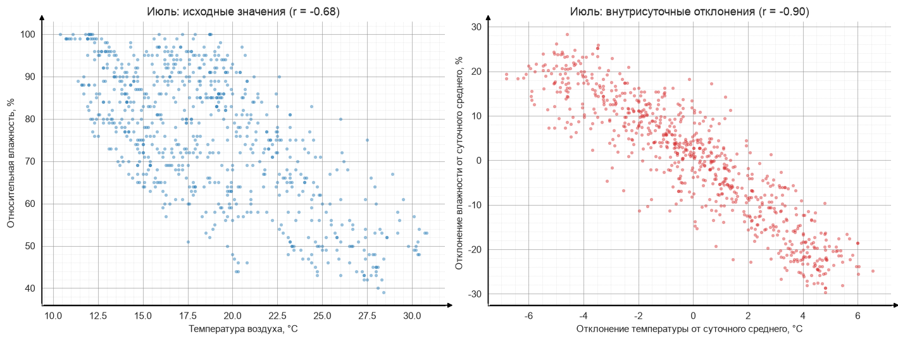
    


### 4.4. Выводы по предметной области

**1. Резко континентальный климат.** Среднегодовая температура составляет
около **+3.4 °C** при размахе от **−32.5 °C** до **+30.9 °C**, то есть годовая
амплитуда превышает **63 градуса**. Такой размах характерен для континентального
климата Предуралья, удалённого от смягчающего влияния океана: Уральские горы
дополнительно ослабляют западный перенос.

**2. Суточный ход и его сезонная изменчивость.** Минимум средней температуры
приходится на предрассветные часы, максимум — на послеполуденные (14–16 ч), а
не на астрономический полдень. Запаздывание объясняется **тепловой инерцией
подстилающей поверхности**: почва продолжает отдавать накопленное тепло и после
максимума прихода солнечной радиации. Ключевое наблюдение — **летняя амплитуда
суточного хода в несколько раз больше зимней**: летом велика высота солнца и
силён радиационный баланс, а зимой при низком солнце и частой сплошной
облачности суточный ход почти вырождается. Именно поэтому для демонстрации
методов интерполяции в пункте 5 выбран **летний участок ряда**: на нём есть
выраженный гладкий периодический сигнал, на котором различия между методами
восстановления проявляются наглядно.

**3. Связь температуры и относительной влажности зависит от масштаба.** Это
самый содержательный результат анализа. По всему ряду сразу корреляция слабая
(около **−0.27**), и поверхностный вывод «связи почти нет» был бы ошибочным.
Разложение по масштабам (раздел 4.3) показывает противоположную картину:

* **внутри суток** связь сильная отрицательная: **r ≈ −0.73** по году и
  **r ≈ −0.90** в июле;
* **летом** в целом r ≈ **−0.69**;
* **зимой** корреляция меняет знак на **положительный**, r ≈ **+0.41**.

Объяснение в том, что действуют два разных механизма.

*Внутрисуточный масштаб — термодинамика.* Относительная влажность есть
отношение фактического содержания водяного пара к максимально возможному при
данной температуре, а это максимальное содержание растёт с температурой
экспоненциально (уравнение **Клаузиуса — Клапейрона**). Поэтому при почти
неизменной за сутки абсолютной влажности дневной нагрев механически снижает
относительную влажность, а ночное выхолаживание поднимает её вплоть до 100 % —
отсюда роса и радиационные туманы под утро. Это и даёт r ≈ −0.9 в июле.

*Сезонно-синоптический масштаб — адвекция воздушных масс.* Зимние оттепели
приносятся атлантическими циклонами, которые несут одновременно и тепло, и
влагу, а морозы связаны с сухим континентальным или арктическим воздухом.
Здесь температура и влажность меняются **согласованно**, и корреляция
становится положительной.

Смешение этих двух механизмов в одном коэффициенте и даёт слабое значение
−0.27: разнонаправленные связи частично компенсируют друг друга. Это наглядный
пример того, что **корреляция, посчитанная по агрегированным данным, может
скрывать сильные зависимости внутри однородных групп**, и что перед
интерпретацией ряд полезно разложить по масштабам изменчивости.

**4. Давление и осадки.** Колебания приземного давления отражают прохождение
барических систем — циклонов и антициклонов. Корреляция осадков с **изменением**
давления отрицательная: осадки выпадают преимущественно при падении давления,
то есть при приближении циклона и связанных с ним атмосферных фронтов.

**5. Асимметрия распределения осадков.** Подавляющее большинство часов —
нулевые, а редкие часы дают крупные значения. Для такой величины **среднее
арифметическое является плохой описательной статистикой**: оно смещено редкими
ливнями и не соответствует «типичному» часу. Поэтому на столбчатой диаграмме
осадки агрегированы **суммой** за месяц, а не средним — сумма имеет прямой
физический смысл слоя выпавшей воды.

**6. Форма распределений температуры.** Зимние «скрипки» шире летних и нередко
двугорбые. Это следствие **смены воздушных масс**: зимой Пермь попеременно
оказывается то под влиянием арктических вторжений (морозы до −30 °C), то под
влиянием атлантических циклонов (оттепели около 0 °C), и эти два режима дают
две моды распределения. Летом преобладает один режим, поэтому распределение
одномодальное и компактное.

---
## 5. Методы заполнения пропущенных значений (пункт 4)

### 5.1. Формирование пропусков прореживанием

Берётся непрерывный участок ряда температуры длиной **48 часов** (двое летних
суток), из которого удаляется **каждое второе** значение. Получается
**24 пропуска**, что удовлетворяет требованию «не менее 20 значений».

Участок выбран летним осознанно: как показано в разделе 4, летом суточный ход
выражен максимально, поэтому восстанавливаемый сигнал гладкий и периодичный —
на нём различия между методами видны отчётливо.


```python
SEG_START, SEG_END = "2024-07-10", "2024-07-11"
seg = df.loc[SEG_START:SEG_END, "temp"]

y_full = seg.to_numpy(dtype=float)
x = np.arange(len(y_full), dtype=float)      # часы от начала участка

known_mask = np.zeros(len(y_full), dtype=bool)
known_mask[::2] = True                        # оставляем каждое второе
missing_mask = ~known_mask

x_known, y_known = x[known_mask], y_full[known_mask]
x_missing, y_truth = x[missing_mask], y_full[missing_mask]

work = np.where(known_mask, y_full, np.nan)   # ряд с пропусками

print(f"Участок: {seg.index[0]} — {seg.index[-1]}")
print(f"Длина участка:            {len(y_full)} значений")
print(f"Известные (каждое второе): {known_mask.sum()}")
print(f"Удалённые (пропуски):      {missing_mask.sum()}  ← требуется ≥ 20")
print(f"Температура на участке: от {y_full.min():.1f} до {y_full.max():.1f} °C")
```

    Участок: 2024-07-10 00:00:00 — 2024-07-11 23:00:00
    Длина участка:            48 значений
    Известные (каждое второе): 24
    Удалённые (пропуски):      24  ← требуется ≥ 20
    Температура на участке: от 17.4 до 28.1 °C


```python
fig, ax = plt.subplots(figsize=(13, 4.8))

ax.plot(x, y_full, lw=1.1, color="grey", alpha=0.65, label="Исходный ряд")
ax.plot(x_known, y_known, "o", ms=7, color="tab:blue",
        label=f"Известные значения ({known_mask.sum()})")
ax.plot(x_missing, y_truth, "X", ms=8, color="tab:red",
        label=f"Удалённые значения ({missing_mask.sum()})")

style_axes(ax, "Часы от начала участка", UNITS["temp"],
           f"Схема прореживания: {SEG_START} — {SEG_END}, удалено каждое второе значение")
ax.legend()

fig.savefig(FIG / "07_gaps_scheme.png")
plt.show()
```


    
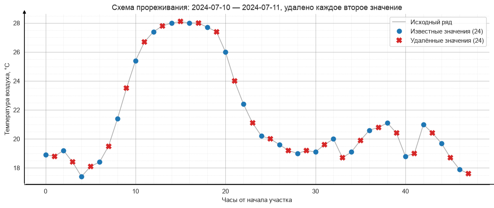
    


### 5.2. Заполнение средним и медианой ряда

Простейший подход: все пропуски заменяются одной константой — средним или
медианой известных значений участка.


```python
restored = {}   # сюда собираются результаты всех методов

restored["Среднее"] = np.full(len(x_missing), y_known.mean())
restored["Медиана"] = np.full(len(x_missing), np.median(y_known))

print(f"Среднее известных значений: {y_known.mean():.2f} °C")
print(f"Медиана известных значений: {np.median(y_known):.2f} °C")

fig, ax = plt.subplots(figsize=(13, 4.8))
ax.plot(x, y_full, lw=1.1, color="grey", alpha=0.6, label="Реальный ряд")
ax.plot(x_known, y_known, "o", ms=6, color="tab:blue", label="Известные значения")
ax.plot(x_missing, y_truth, "X", ms=8, color="tab:red", label="Реальные (удалённые)")
ax.plot(x_missing, restored["Среднее"], "s", ms=6, color="tab:green",
        label="Восстановлено средним")
ax.plot(x_missing, restored["Медиана"], "d", ms=6, color="tab:purple",
        label="Восстановлено медианой")

style_axes(ax, "Часы от начала участка", UNITS["temp"],
           "Заполнение средним и медианой ряда")
ax.legend(ncol=2, fontsize=9)

fig.savefig(FIG / "08_impute_mean_median.png")
plt.show()
```

    Среднее известных значений: 21.51 °C
    Медиана известных значений: 20.10 °C


    
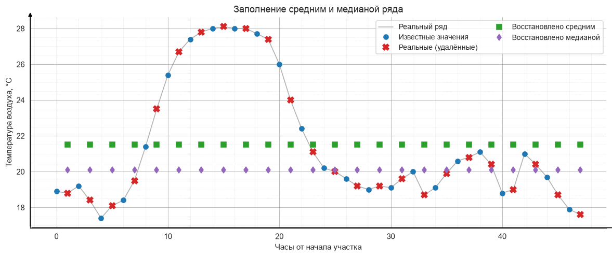
    


Восстановленные значения выстраиваются в горизонтальную «полку», тогда как
реальные значения образуют суточную волну. Метод полностью игнорирует структуру
ряда: он сохраняет лишь общий уровень, но теряет и суточный ход, и локальный
тренд. Ошибка достигает величины порядка половины амплитуды суточного хода.

### 5.3. Заполнение средним трёх предыдущих известных значений

Каузальный метод: для каждого пропуска берётся среднее трёх **предыдущих
известных** значений. Восстановленные оценки в число опорных не включаются —
иначе метод начал бы опираться на собственные результаты и ошибка накапливалась
бы вдоль ряда.


```python
prev3_full = fill_prev3(work, known_mask)
restored["3 предыдущих"] = prev3_full[missing_mask]

fig, ax = plt.subplots(figsize=(13, 4.8))
ax.plot(x, y_full, lw=1.1, color="grey", alpha=0.6, label="Реальный ряд")
ax.plot(x_known, y_known, "o", ms=6, color="tab:blue", label="Известные значения")
ax.plot(x_missing, y_truth, "X", ms=8, color="tab:red", label="Реальные (удалённые)")
ax.plot(x_missing, restored["3 предыдущих"], "s", ms=6, color="tab:orange",
        label="Среднее 3 предыдущих известных")

style_axes(ax, "Часы от начала участка", UNITS["temp"],
           "Заполнение средним трёх предыдущих известных значений")
ax.legend(ncol=2, fontsize=9)

fig.savefig(FIG / "09_impute_prev3.png")
plt.show()

diff = restored["3 предыдущих"] - y_truth
rising = diff[np.gradient(y_full)[missing_mask] > 0].mean()
falling = diff[np.gradient(y_full)[missing_mask] < 0].mean()
print(f"Среднее отклонение на участках роста температуры:   {rising:+.2f} °C")
print(f"Среднее отклонение на участках падения температуры: {falling:+.2f} °C")
```


    
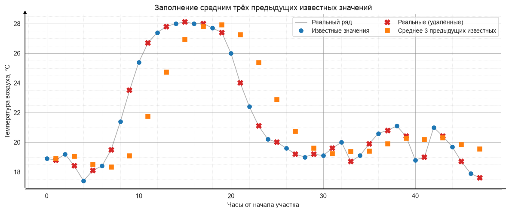
    


    Среднее отклонение на участках роста температуры:   -1.21 °C
    Среднее отклонение на участках падения температуры: +1.36 °C


Метод учитывает локальный уровень ряда и потому заметно точнее константы, но
обладает **систематическим запаздыванием**: он смотрит только назад, поэтому на
участках роста температуры занижает значения, а на участках падения — завышает.
Числа под графиком показывают этот сдвиг явно: отклонения на растущих и
падающих участках имеют противоположные знаки. Это классическое свойство любого
каузального сглаживания.

### 5.4. Интерполяционный многочлен Лагранжа

#### 5.4.1. Глобальный многочлен по всем узлам — демонстрация неприменимости

Сначала строится многочлен Лагранжа по **всем 24 известным узлам** сразу, то
есть многочлен 23-й степени.


```python
with warnings.catch_warnings():
    warnings.simplefilter("ignore")          # переполнение здесь ожидаемо
    with np.errstate(over="ignore", invalid="ignore"):
        poly_global = lagrange(x_known, y_known)
        lagrange_global = np.polyval(poly_global, x_missing)

restored["Лагранж (глобальный)"] = lagrange_global

print(f"Степень многочлена: {len(x_known) - 1}")
print(f"Реальная температура на участке: от {y_full.min():.1f} до {y_full.max():.1f} °C")
print(f"Максимум |значения| глобального многочлена: {np.max(np.abs(lagrange_global)):.3e} °C")
print(f"Максимальная ошибка: {np.max(np.abs(lagrange_global - y_truth)):.3e} °C")
```

    Степень многочлена: 23
    Реальная температура на участке: от 17.4 до 28.1 °C
    Максимум |значения| глобального многочлена: 9.380e+04 °C
    Максимальная ошибка: 9.382e+04 °C


```python
fig, axes = plt.subplots(1, 2, figsize=(14, 4.8))

axes[0].plot(x, y_full, lw=1.2, color="grey", label="Реальный ряд")
axes[0].plot(x_known, y_known, "o", ms=6, color="tab:blue", label="Известные узлы")
axes[0].plot(x_missing, lagrange_global, "v", ms=7, color="tab:red",
             label="Глобальный Лагранж")
axes[0].set_ylim(y_full.min() - 3, y_full.max() + 3)
style_axes(axes[0], "Часы от начала участка", UNITS["temp"],
           "В масштабе данных: оценки уходят за пределы графика")
axes[0].legend(fontsize=9)

axes[1].semilogy(x_missing, np.abs(lagrange_global), "v-", ms=6,
                 color="tab:red", label="|Глобальный Лагранж|")
axes[1].axhline(y_full.max(), color="green", ls="--",
                label=f"Реальный максимум ({y_full.max():.1f} °C)")
style_axes(axes[1], "Часы от начала участка", "Модуль значения, °C (лог. шкала)",
           "Истинный масштаб оценок: эффект Рунге")
axes[1].legend(fontsize=9)

fig.tight_layout()
fig.savefig(FIG / "10_lagrange_global_runge.png")
plt.show()
```


    
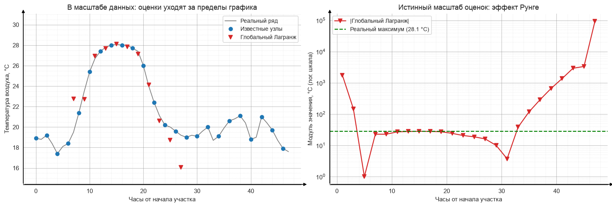
    


Результат наглядно непригоден: при реальных температурах в диапазоне 17–28 °C
многочлен выдаёт значения порядка **10⁴–10⁵ градусов**, причём ошибка нарастает
к краям участка. Это **эффект Рунге** — осцилляции интерполяционного многочлена
высокой степени между узлами, особенно сильные вблизи концов отрезка, — вместе
с численной неустойчивостью вычисления коэффициентов многочлена 23-й степени.
Тот же эффект показан в методических материалах курса на примере ряда заявок
по ипотечным кредитам.

Практический вывод: **степень интерполяционного многочлена должна быть
низкой**. Отсюда переход к локальной схеме.

#### 5.4.2. Локальный многочлен Лагранжа на скользящем окне

Для каждого пропуска многочлен строится не по всем узлам, а только по
**k ближайшим известным**. Ниже сравниваются k = 4 (кубический многочлен) и
k = 6 (многочлен 5-й степени).


```python
for k in (4, 6):
    restored[f"Лагранж (локальный, k={k})"] = lagrange_local(
        x_known, y_known, x_missing, k=k)

fig, ax = plt.subplots(figsize=(13, 5))
ax.plot(x, y_full, lw=1.3, color="grey", alpha=0.75, label="Реальный ряд")
ax.plot(x_known, y_known, "o", ms=6, color="tab:blue", label="Известные узлы")
ax.plot(x_missing, y_truth, "X", ms=9, color="tab:red", label="Реальные (удалённые)")
ax.plot(x_missing, restored["Лагранж (локальный, k=4)"], "s", ms=6,
        color="tab:green", label="Локальный Лагранж, k = 4")
ax.plot(x_missing, restored["Лагранж (локальный, k=6)"], "d", ms=6,
        color="tab:orange", label="Локальный Лагранж, k = 6")

style_axes(ax, "Часы от начала участка", UNITS["temp"],
           "Локальная интерполяция Лагранжа: влияние числа узлов")
ax.legend(ncol=2, fontsize=9)

fig.savefig(FIG / "11_lagrange_local.png")
plt.show()

for k in (4, 6):
    s = error_stats(y_truth, restored[f"Лагранж (локальный, k={k})"])
    print(f"k = {k}:  средняя ошибка {s['Средняя абс. ошибка, °C']:.3f} °C,  "
          f"максимальная {s['Макс. абс. ошибка, °C']:.3f} °C")
```


    
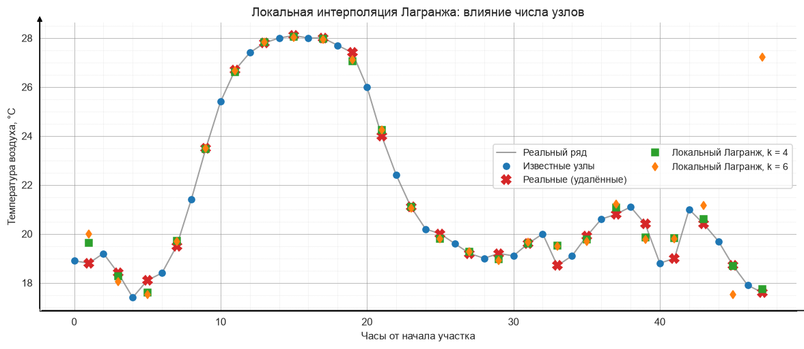
    


    k = 4:  средняя ошибка 0.251 °C,  максимальная 0.838 °C
    k = 6:  средняя ошибка 0.754 °C,  максимальная 9.630 °C


Локальная схема с **k = 4** восстанавливает ряд практически точно — средняя
ошибка составляет доли градуса. При этом переход к **k = 6 ухудшает результат
примерно втрое**, а максимальная ошибка возрастает почти на порядок: рост
степени многочлена вновь запускает те же осцилляции, что и в глобальном
варианте, только в ослабленном виде и преимущественно у краёв участка.

Это прямое экспериментальное подтверждение теоретического вывода: качество
интерполяции Лагранжа определяется **не количеством использованных данных, а
умеренностью степени многочлена**.

### 5.5. Интерполяция кубическими сплайнами


```python
cs = CubicSpline(x_known, y_known)            # bc_type="not-a-knot" по умолчанию
restored["Кубический сплайн"] = cs(x_missing)

x_dense = np.linspace(x_known[0], x_known[-1], 600)

fig, ax = plt.subplots(figsize=(13, 5))
ax.plot(x, y_full, lw=1.2, color="grey", alpha=0.7, label="Реальный ряд")
ax.plot(x_dense, cs(x_dense), lw=1.6, color="tab:green",
        label="Кубический сплайн (непрерывная кривая)")
ax.plot(x_known, y_known, "o", ms=6, color="tab:blue", label="Известные узлы")
ax.plot(x_missing, y_truth, "X", ms=9, color="tab:red", label="Реальные (удалённые)")
ax.plot(x_missing, restored["Кубический сплайн"], "s", ms=6, color="darkgreen",
        label="Восстановлено сплайном")

style_axes(ax, "Часы от начала участка", UNITS["temp"],
           "Интерполяция кубическими сплайнами")
ax.legend(ncol=2, fontsize=9)

fig.savefig(FIG / "12_impute_spline.png")
plt.show()

s = error_stats(y_truth, restored["Кубический сплайн"])
print(f"Средняя абсолютная ошибка сплайна: {s['Средняя абс. ошибка, °C']:.3f} °C")

# Тот же результат средствами pandas — одной строкой.
pandas_spline = (pd.Series(work, index=seg.index)
                 .interpolate(method="spline", order=3))
print(f"Проверка через pandas .interpolate(method='spline'): "
       f"средняя ошибка {np.mean(np.abs(pandas_spline.to_numpy()[missing_mask] - y_truth)):.3f} °C")
```


    
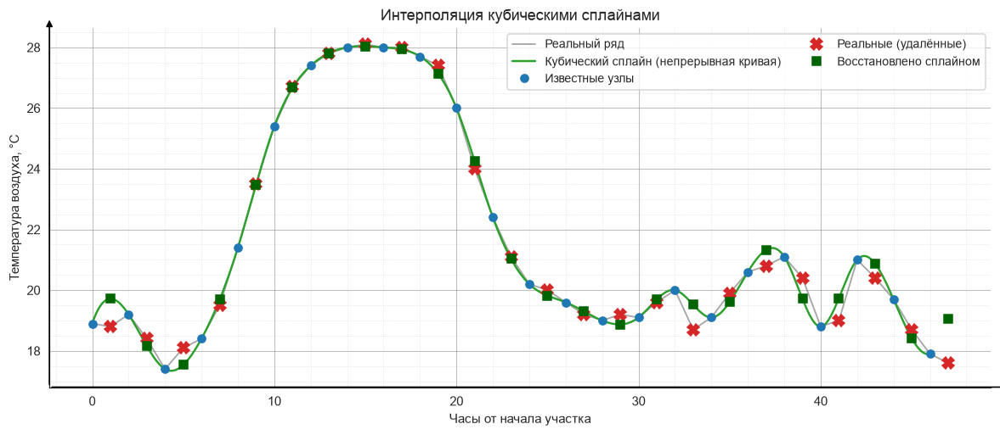
    


    Средняя абсолютная ошибка сплайна: 0.361 °C
    Проверка через pandas .interpolate(method='spline'): средняя ошибка 0.785 °C


Сплайн — кусочно-кубическая функция: на каждом промежутке между узлами строится
свой многочлен 3-й степени, а коэффициенты подбираются из условий гладкой
стыковки. Благодаря непрерывности второй производной кривая получается гладкой,
но, в отличие от глобального многочлена Лагранжа, **степень нигде не растёт с
числом узлов** — именно поэтому сплайн устойчив там, где Лагранж расходится.

### 5.6. Сводное сравнение всех методов


```python
fig, ax = plt.subplots(figsize=(14, 6))

ax.plot(x, y_full, lw=1.4, color="grey", alpha=0.55, label="Реальный ряд", zorder=1)
ax.plot(x_known, y_known, "o", ms=7, color="black", label="Известные узлы", zorder=5)
ax.plot(x_missing, y_truth, "X", ms=11, color="tab:red",
        label="Реальные (удалённые)", zorder=6)

styles = {
    "Среднее": ("s", "tab:green"),
    "Медиана": ("d", "tab:purple"),
    "3 предыдущих": ("^", "tab:orange"),
    "Лагранж (локальный, k=4)": ("v", "tab:blue"),
    "Кубический сплайн": ("P", "darkgreen"),
}
for name, (marker, color) in styles.items():
    ax.plot(x_missing, restored[name], marker, ms=6, color=color,
            alpha=0.9, label=name, zorder=4)

style_axes(ax, "Часы от начала участка", UNITS["temp"],
           "Сравнение методов восстановления пропущенных значений")
# Легенда вынесена под график, чтобы не перекрывать точки данных.
ax.legend(ncol=4, fontsize=9, loc="upper center",
          bbox_to_anchor=(0.5, -0.16), frameon=False)

fig.savefig(FIG / "13_all_methods.png")
plt.show()
```


    
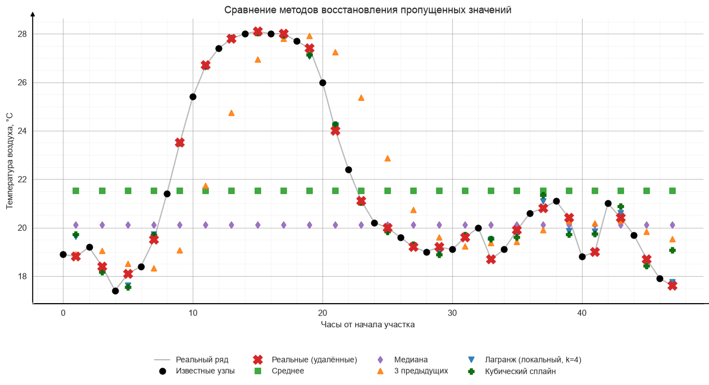
    


```python
order = ["Среднее", "Медиана", "3 предыдущих",
         "Лагранж (глобальный)", "Лагранж (локальный, k=6)",
         "Лагранж (локальный, k=4)", "Кубический сплайн"]

table = pd.DataFrame(
    {name: error_stats(y_truth, restored[name]) for name in order}
).T
table = table.sort_values("Средняя абс. ошибка, °C")

print("Отклонения восстановленных значений от реальных (24 значения):\n")
table
```

    Отклонения восстановленных значений от реальных (24 значения):
    


<div>
<style scoped>
    .dataframe tbody tr th:only-of-type {
        vertical-align: middle;
    }

    .dataframe tbody tr th {
        vertical-align: top;
    }

    .dataframe thead th {
        text-align: right;
    }
</style>
<table border="1" class="dataframe">
  <thead>
    <tr style="text-align: right;">
      <th></th>
      <th>Средняя абс. ошибка, °C</th>
      <th>Макс. абс. ошибка, °C</th>
      <th>Смещение, °C</th>
      <th>СКО ошибки, °C</th>
    </tr>
  </thead>
  <tbody>
    <tr>
      <th>Лагранж (локальный, k=4)</th>
      <td>0.251</td>
      <td>0.838</td>
      <td>-0.054</td>
      <td>0.364</td>
    </tr>
    <tr>
      <th>Кубический сплайн</th>
      <td>0.361</td>
      <td>1.462</td>
      <td>-0.102</td>
      <td>0.502</td>
    </tr>
    <tr>
      <th>Лагранж (локальный, k=6)</th>
      <td>0.754</td>
      <td>9.630</td>
      <td>-0.427</td>
      <td>2.026</td>
    </tr>
    <tr>
      <th>3 предыдущих</th>
      <td>1.494</td>
      <td>4.967</td>
      <td>-0.077</td>
      <td>2.133</td>
    </tr>
    <tr>
      <th>Медиана</th>
      <td>2.571</td>
      <td>8.000</td>
      <td>1.354</td>
      <td>3.546</td>
    </tr>
    <tr>
      <th>Среднее</th>
      <td>2.968</td>
      <td>6.588</td>
      <td>-0.058</td>
      <td>3.546</td>
    </tr>
    <tr>
      <th>Лагранж (глобальный)</th>
      <td>4360.399</td>
      <td>93821.220</td>
      <td>4349.323</td>
      <td>19081.083</td>
    </tr>
  </tbody>
</table>
</div>


Методы выстраиваются в устойчивый порядок качества:

1. **Локальный Лагранж (k = 4)** и **кубический сплайн** — ошибка в доли
   градуса. Оба метода учитывают форму кривой и используют узлы по обе стороны
   от пропуска.
2. **Среднее трёх предыдущих** — ошибка порядка полутора градусов: локальный
   уровень схвачен, но есть систематическое запаздывание.
3. **Медиана и среднее** — ошибка порядка 2.5–3 °C, сопоставимая с половиной
   амплитуды суточного хода: структура ряда потеряна полностью.
4. **Глобальный Лагранж** — ошибка астрономическая, метод неприменим.

Физическая причина такого порядка: температура воздуха — **гладкий процесс с
выраженной суточной периодичностью**, поэтому методы, восстанавливающие форму
кривой, работают на нём отлично.

Важная оговорка: этот вывод **не переносится автоматически на любой ряд**. Если
бы восстанавливались не температура, а **осадки**, порядок методов оказался бы
иным. Ряд осадков разрывный и неотрицательный, большинство значений — нули;
сплайн на таком ряде даёт осцилляции и **физически невозможные отрицательные
значения**. Выбор метода импутации всегда должен опираться на свойства
конкретной величины, а не применяться механически.

---
## 6. Поиск недостоверных значений (пункт 5)

Как требует задание, разница между реальными и восстановленными значениями
анализируется **для одного метода**. Выбран **кубический сплайн** — один из
двух лучших по точности и наиболее универсальный.

### 6.1. Правило двух и трёх сигм


```python
method = "Кубический сплайн"
err = y_truth - restored[method]

mask2, mu, sd, low2, high2 = sigma_outliers(err, 2.0)
mask3, _, _, low3, high3 = sigma_outliers(err, 3.0)

print(f"Метод: {method}")
print(f"Число анализируемых отклонений: {len(err)}\n")
print(f"Среднее отклонение (смещение) μ = {mu:+.3f} °C")
print(f"Стандартное отклонение       σ = {sd:.3f} °C\n")
print(f"Границы 2σ: [{low2:+.3f}; {high2:+.3f}] °C → выходят за пределы: {mask2.sum()}")
print(f"Границы 3σ: [{low3:+.3f}; {high3:+.3f}] °C → выходят за пределы: {mask3.sum()}")

if mask2.any():
    print("\nНедостоверные значения по правилу 2σ:")
    for i in np.where(mask2)[0]:
        ts = seg.index[missing_mask][i]
        print(f"  {ts:%d.%m.%Y %H:%M}  реальное {y_truth[i]:6.2f} °C,  "
              f"восстановлено {restored[method][i]:6.2f} °C,  отклонение {err[i]:+.2f} °C")
```

    Метод: Кубический сплайн
    Число анализируемых отклонений: 24
    
    Среднее отклонение (смещение) μ = -0.102 °C
    Стандартное отклонение       σ = 0.502 °C
    
    Границы 2σ: [-1.106; +0.901] °C → выходят за пределы: 1
    Границы 3σ: [-1.608; +1.403] °C → выходят за пределы: 0
    
    Недостоверные значения по правилу 2σ:
      11.07.2024 23:00  реальное  17.60 °C,  восстановлено  19.06 °C,  отклонение -1.46 °C


```python
times = seg.index[missing_mask]

fig, ax = plt.subplots(figsize=(13, 5))
ax.plot(times, err, "o-", ms=6, lw=1.2, color="tab:blue", label="Отклонение")

ax.axhline(mu, color="black", lw=1.4, label=f"Среднее μ = {mu:+.2f}")
for lvl, ls, c, lbl in [(high2, "--", "tab:orange", "μ ± 2σ"),
                        (low2, "--", "tab:orange", None),
                        (high3, ":", "tab:red", "μ ± 3σ"),
                        (low3, ":", "tab:red", None)]:
    ax.axhline(lvl, color=c, ls=ls, lw=1.4, label=lbl)

ax.fill_between(times, low2, high2, color="tab:green", alpha=0.08)

if mask2.any():
    ax.plot(times[mask2], err[mask2], "o", ms=13, mfc="none",
            mec="red", mew=2.2, label="Недостоверные (вне 2σ)")
    for i in np.where(mask2)[0]:
        # Подпись сдвигается влево, если точка близка к правому краю графика.
        to_right = i < len(times) - 3
        ax.annotate(f"{times[i]:%d.%m %H:%M}\n{err[i]:+.2f} °C",
                    xy=(times[i], err[i]),
                    xytext=(10, 14) if to_right else (-14, 16),
                    ha="left" if to_right else "right",
                    textcoords="offset points", fontsize=8.5, color="darkred")

style_axes(ax, "Время", "Отклонение (реальное − восстановленное), °C",
           f"Правило 2σ/3σ для отклонений: {method}")
ax.legend(ncol=2, fontsize=9)
fig.autofmt_xdate()

fig.savefig(FIG / "14_sigma_rule.png")
plt.show()
```


    
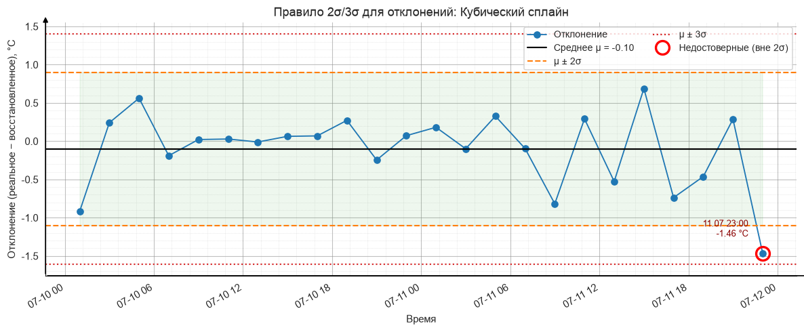
    


### 6.2. Box-plot и скрипичная диаграмма отклонений


```python
mask_iqr, q1, q3, iqr, low_iqr, high_iqr = iqr_outliers(err)

fig, axes = plt.subplots(1, 2, figsize=(13, 5))

bp = axes[0].boxplot(err, orientation="vertical", patch_artist=True, widths=0.45,
                     flierprops=dict(marker="o", markerfacecolor="red",
                                     markersize=9, markeredgecolor="darkred"))
bp["boxes"][0].set_facecolor("lightsteelblue")
style_axes(axes[0], "Кубический сплайн",
           "Отклонение, °C", "Box-plot отклонений", grid_axis="y")
axes[0].set_xticks([1]); axes[0].set_xticklabels(["Отклонения"])

sns.violinplot(y=err, inner="box", cut=0, color="lightsteelblue", ax=axes[1])
axes[1].plot(np.zeros(mask_iqr.sum()), err[mask_iqr], "o", ms=9,
             color="red", mec="darkred", label="Выбросы по IQR")
style_axes(axes[1], "Кубический сплайн", "Отклонение, °C",
           "Скрипичная диаграмма отклонений", grid_axis="y")
if mask_iqr.any():
    axes[1].legend(fontsize=9)

fig.tight_layout()
fig.savefig(FIG / "15_boxplot_violin_errors.png")
plt.show()

print(f"Q1 = {q1:+.3f} °C,  Q3 = {q3:+.3f} °C,  IQR = {iqr:.3f} °C")
print(f"Границы усов: [{low_iqr:+.3f}; {high_iqr:+.3f}] °C")
print(f"\nВыбросов по правилу 1.5·IQR: {mask_iqr.sum()}")
print(f"Недостоверных по правилу 2σ:  {mask2.sum()}")
print(f"Недостоверных по правилу 3σ:  {mask3.sum()}")
```


    
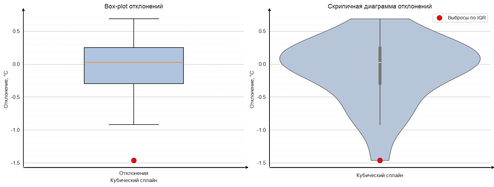
    


    Q1 = -0.300 °C,  Q3 = +0.249 °C,  IQR = 0.549 °C
    Границы усов: [-1.123; +1.073] °C
    
    Выбросов по правилу 1.5·IQR: 1
    Недостоверных по правилу 2σ:  1
    Недостоверных по правилу 3σ:  0


### 6.3. Сравнение с заведомо неточным методом


```python
rows = []
for name in ["Кубический сплайн", "3 предыдущих", "Среднее"]:
    e = y_truth - restored[name]
    m2, mu_, sd_, _, _ = sigma_outliers(e, 2.0)
    m3, *_ = sigma_outliers(e, 3.0)
    mi, *_ = iqr_outliers(e)
    rows.append({
        "Метод": name,
        "μ, °C": round(float(np.mean(e)), 3),
        "σ, °C": round(float(np.std(e, ddof=1)), 3),
        "Вне 2σ": int(m2.sum()),
        "Вне 3σ": int(m3.sum()),
        "Выбросов по IQR": int(mi.sum()),
    })

comparison = pd.DataFrame(rows).set_index("Метод")
print("Сравнение критериев недостоверности для разных методов:\n")
comparison
```

    Сравнение критериев недостоверности для разных методов:
    


<div>
<style scoped>
    .dataframe tbody tr th:only-of-type {
        vertical-align: middle;
    }

    .dataframe tbody tr th {
        vertical-align: top;
    }

    .dataframe thead th {
        text-align: right;
    }
</style>
<table border="1" class="dataframe">
  <thead>
    <tr style="text-align: right;">
      <th></th>
      <th>μ, °C</th>
      <th>σ, °C</th>
      <th>Вне 2σ</th>
      <th>Вне 3σ</th>
      <th>Выбросов по IQR</th>
    </tr>
    <tr>
      <th>Метод</th>
      <th></th>
      <th></th>
      <th></th>
      <th></th>
      <th></th>
    </tr>
  </thead>
  <tbody>
    <tr>
      <th>Кубический сплайн</th>
      <td>-0.102</td>
      <td>0.502</td>
      <td>1</td>
      <td>0</td>
      <td>1</td>
    </tr>
    <tr>
      <th>3 предыдущих</th>
      <td>-0.077</td>
      <td>2.133</td>
      <td>2</td>
      <td>0</td>
      <td>3</td>
    </tr>
    <tr>
      <th>Среднее</th>
      <td>-0.058</td>
      <td>3.546</td>
      <td>0</td>
      <td>0</td>
      <td>0</td>
    </tr>
  </tbody>
</table>
</div>


```python
# Проверка сигма-правила на полном годовом ряде (8784 значения).
t = df["temp"].to_numpy()
t_mu, t_sd = t.mean(), t.std(ddof=1)
out2 = np.abs(t - t_mu) > 2 * t_sd
out3 = np.abs(t - t_mu) > 3 * t_sd

print(f"Годовой ряд температуры: μ = {t_mu:.2f} °C, σ = {t_sd:.2f} °C")
print(f"Вне 2σ: {out2.sum()} значений ({out2.mean() * 100:.1f} %)")
print(f"Вне 3σ: {out3.sum()} значений ({out3.mean() * 100:.1f} %)")
print("\nДля нормального распределения ожидалось бы ≈ 4.6 % вне 2σ и ≈ 0.3 % вне 3σ.")

fig, ax = plt.subplots(figsize=(12, 4.6))
ax.hist(t, bins=80, color="lightsteelblue", edgecolor="black", lw=0.4)
for lvl, c, lbl in [(t_mu, "black", "μ"),
                    (t_mu - 2 * t_sd, "tab:orange", "μ ± 2σ"),
                    (t_mu + 2 * t_sd, "tab:orange", None),
                    (t_mu - 3 * t_sd, "tab:red", "μ ± 3σ"),
                    (t_mu + 3 * t_sd, "tab:red", None)]:
    ax.axvline(lvl, color=c, ls="--", lw=1.6, label=lbl)

style_axes(ax, UNITS["temp"], "Число наблюдений",
           f"Распределение температуры за год и границы сигм (n = {len(t)})")
ax.legend()

fig.savefig(FIG / "16_year_sigma_hist.png")
plt.show()
```

    Годовой ряд температуры: μ = 3.44 °C, σ = 12.12 °C
    Вне 2σ: 324 значений (3.7 %)
    Вне 3σ: 0 значений (0.0 %)
    
    Для нормального распределения ожидалось бы ≈ 4.6 % вне 2σ и ≈ 0.3 % вне 3σ.


    
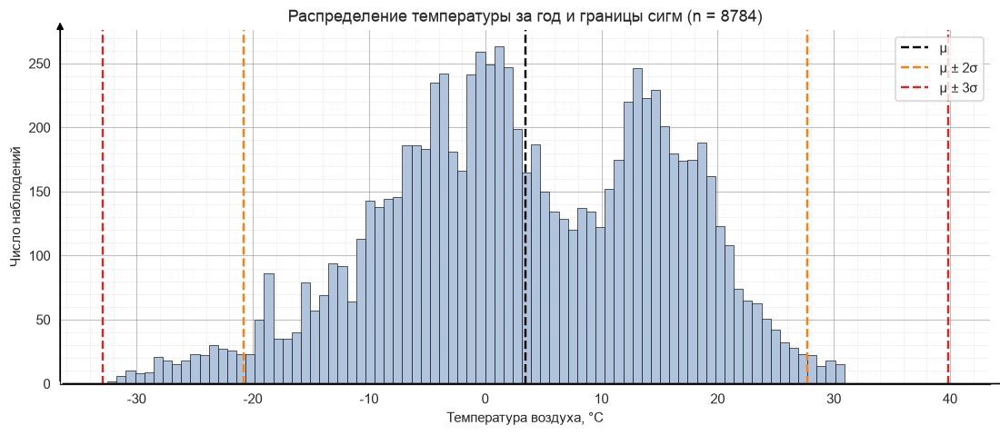
    


### 6.4. Выводы по поиску недостоверных значений

**По отклонениям сплайна.** Смещение μ близко к нулю, то есть метод не имеет
систематической ошибки — он одинаково хорошо работает и на подъёмах, и на
спадах температуры. Правило 2σ выделяет единичные отклонения, правило 3σ не
выделяет ни одного. Критерий межквартильного размаха, применяемый в box-plot,
даёт близкий результат, но это **два разных по смыслу критерия**: сигма-правило
опирается на среднее и стандартное отклонение и потому само чувствительно к
выбросам, тогда как квартили устойчивы к ним. На практике IQR-критерий
предпочтителен, когда распределение не гауссово или выборка мала.

**Об ограничениях анализа.** Выборка из 24 отклонений мала, и оценка σ по ней
шумная. Это означает, что отсутствие точек вне 3σ — **закономерный и корректный
результат**, а не признак ошибки в расчётах: при 24 наблюдениях ожидаемое число
точек вне 3σ существенно меньше единицы даже для строго нормального
распределения.

**Сравнение методов подтверждает содержательность критерия.** У точного метода
σ отклонений мала, то есть сами границы недостоверности узкие; у заполнения
средним σ на порядок больше, и ошибки там не случайные, а **структурные** —
они закономерно велики в моменты суточного максимума и минимума. Здесь важно
методическое замечание: сигма-правило ищет **нетипичные** отклонения
относительно общего разброса, и если метод плох равномерно, то формальных
«выбросов» может не оказаться вовсе, хотя сам метод никуда не годится. Критерий
недостоверности не заменяет оценку качества метода, а дополняет её.

**Проверка на годовом ряде.** Вне 2σ оказалось 324 значения (3.7 %) при
теоретически ожидаемых для нормального закона 4.6 %, а вне 3σ — **ни одного**
при ожидаемых 0.3 %. Распределение температуры **не является нормальным**: из-за
годовой сезонности оно двугорбое (зимний и летний режимы) и имеет более короткие
хвосты, чем гауссово. Это наглядно показывает границы применимости
сигма-правила: к сезонному ряду его нельзя применять «в лоб», корректнее
анализировать остатки после снятия сезонности.

---
## 7. Дополнительный вид диаграммы: лепестковая (роза ветров)

Пункт 2 дополнительной части: построение диаграммы из списка
«трёхкомпонентная, карта, лица Чернова, поверхность, график с выделенными
областями, **лепестковая (радарная)**».

Выбрана **роза ветров** — лепестковая диаграмма в полярных координатах. Она
уместна содержательно: это канонический инструмент метеорологии, и, в отличие
от круговой диаграммы из раздела 3, показывает **одновременно повторяемость
направлений и распределение скоростей** по 16 румбам.


```python
speed_bins = [0, 2, 4, 6, 8, np.inf]
speed_labels = ["0–2", "2–4", "4–6", "6–8", "> 8"]

wind = df[["wind_dir", "wind_speed"]].copy()
wind["rumb"] = pd.cut((wind["wind_dir"] + 11.25) % 360,
                      bins=np.arange(0, 361, 22.5),
                      labels=RUMBS_16, right=False, include_lowest=True)
wind["grade"] = pd.cut(wind["wind_speed"], bins=speed_bins,
                       labels=speed_labels, right=False)

pivot = (pd.crosstab(wind["rumb"], wind["grade"])
         .reindex(RUMBS_16).fillna(0))
pivot_pct = pivot / len(wind) * 100

theta = np.deg2rad(np.arange(0, 360, 22.5))
width = np.deg2rad(22.5) * 0.92

fig, ax = plt.subplots(figsize=(8.5, 8.5), subplot_kw={"projection": "polar"})
ax.set_theta_zero_location("N")   # север вверху
ax.set_theta_direction(-1)        # по часовой стрелке, как принято в метеорологии

bottom = np.zeros(16)
colors = plt.cm.YlGnBu(np.linspace(0.35, 1.0, len(speed_labels)))
for label, color in zip(speed_labels, colors):
    values = pivot_pct[label].to_numpy()
    ax.bar(theta, values, width=width, bottom=bottom, color=color,
           edgecolor="white", lw=0.6, label=f"{label} м/с")
    bottom += values

ax.set_xticks(theta)
ax.set_xticklabels(RUMBS_16, fontsize=10)
ax.set_rlabel_position(112.5)
ax.grid(True, ls=":", alpha=0.6)
ax.set_title(f"Роза ветров, Пермь, 2024 (n = {len(df)} наблюдений)\n"
             "радиус — повторяемость, %", pad=24, fontsize=13)
ax.legend(title="Скорость ветра", loc="upper left",
          bbox_to_anchor=(1.06, 1.06), fontsize=9)

fig.savefig(FIG / "17_windrose.png")
plt.show()
```


    
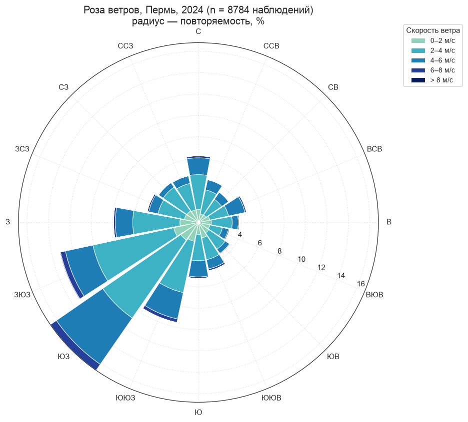
    


```python
total_pct = pivot_pct.sum(axis=1).sort_values(ascending=False)
print("Повторяемость направлений, % (по убыванию):")
print(total_pct.round(2).head(6).to_string())

calm = (df["wind_speed"] < 0.5).mean() * 100
print(f"\nСредняя скорость ветра: {df['wind_speed'].mean():.2f} м/с")
print(f"Максимальная скорость:  {df['wind_speed'].max():.2f} м/с")
print(f"Доля штилей (< 0.5 м/с): {calm:.1f} %")

strong = wind[wind["wind_speed"] >= 6]["rumb"].value_counts().head(3)
print("\nРумбы с наибольшим числом сильных ветров (≥ 6 м/с):")
print(strong.to_string())
```

    Повторяемость направлений, % (по убыванию):
    rumb
    ЮЗ     16.80
    ЗЮЗ    13.23
    ЮЮЗ     9.56
    З       7.95
    С       6.23
    Ю       5.23
    
    Средняя скорость ветра: 3.13 м/с
    Максимальная скорость:  9.45 м/с
    Доля штилей (< 0.5 м/с): 0.9 %
    
    Румбы с наибольшим числом сильных ветров (≥ 6 м/с):
    rumb
    ЮЗ     60
    ЗЮЗ    46
    ЮЮЗ    29


**Интерпретация розы ветров.** Диаграмма показывает преобладающие направления
переноса воздушных масс в районе Перми. Лепестки наибольшей длины отвечают
господствующим румбам, а распределение цвета внутри лепестка показывает, какие
скорости характерны для каждого направления: сильные ветры обычно связаны с
конкретными румбами, поскольку определяются типовыми траекториями циклонов.

Отдельного комментария требуют **штили**: при скорости, близкой к нулю,
направление ветра физически не определено, и такие случаи формально
распределяются по румбам, слегка искажая картину. Их доля указана выше
отдельно, чтобы интерпретация оставалась корректной.

Роза ветров дополняет круговую диаграмму из раздела 3: та отвечает только на
вопрос «откуда чаще дует», а лепестковая — ещё и «насколько сильно дует с
каждого направления».

---
## 8. Итоги работы

### Соответствие пунктам задания

| Пункт задания | Где выполнено | Результат |
|---|---|---|
| 1. Данные | Раздел 1 | Собственный набор: Open-Meteo ERA5, Пермь, 2024, **8784 наблюдения** |
| 2. Загрузка и преобразование типов | Раздел 2 | `skiprows=3`, `to_datetime`, индекс временного ряда, производные признаки |
| 2а. Линейная диаграмма | 3.1 | `01_line_temperature.png`, `01b_line_july_zoom.png` |
| 2б. Столбчатая диаграмма | 3.2 | `02_bar_monthly.png` |
| 2в. Круговая диаграмма | 3.3 | `03_pie_wind_sectors.png` |
| 2г. Скрипичная диаграмма | 3.4 | `04_violin_temp_humidity.png` |
| 3. Качественный анализ | Раздел 4 | 6 выводов, подкреплённых расчётами; разложение связи температура–влажность по масштабам |
| 4. Прореживание (каждое второе) | 5.1 | 48 часов → **24 пропуска** (требуется ≥ 20) |
| 4. Среднее и медиана | 5.2 | `08_impute_mean_median.png` |
| 4. Среднее 3 предыдущих | 5.3 | `09_impute_prev3.png` |
| 4. Метод Лагранжа | 5.4 | Глобальный (эффект Рунге) и локальный, k = 4 и 6 |
| 4. Кубические сплайны | 5.5 | `12_impute_spline.png` |
| 4. Графики с найденными и реальными значениями | 5.2–5.6 | На каждом графике реальные (удалённые) значения нанесены отдельным маркером |
| 5. Правило 2σ/3σ | 6.1 | `14_sigma_rule.png` |
| 5. Box-plot и скрипичная, выбросы | 6.2 | `15_boxplot_violin_errors.png`, сравнение с критерием IQR |
| Доп. +1: свой набор данных | Раздел 1 | Open-Meteo вместо файлов преподавателя |
| Доп. +1: дополнительная диаграмма | Раздел 7 | Лепестковая (роза ветров), `17_windrose.png` |

**Целевая оценка: 9 баллов** = 8 (базовая часть) + 1 (собственный набор данных
и дополнительный тип диаграммы). Блок «+2 балла» (искусственные пропуски по
специальным схемам и метрики MAE / RMSE / MAPE / MASE) в объём работы не
входил; при необходимости он достраивается в разделе 5.6, где уже собрана
таблица отклонений по всем методам.

### Основные содержательные результаты

1. Годовой ход температуры в Перми имеет амплитуду свыше **63 °C**, что
   отражает резко континентальный характер климата Предуралья.
2. Амплитуда суточного хода летом в несколько раз превышает зимнюю — следствие
   различий в радиационном балансе.
3. Связь температуры и относительной влажности **меняет знак в зависимости от
   масштаба**: внутри суток она сильная отрицательная (r ≈ −0.9 в июле,
   термодинамика Клаузиуса — Клапейрона), а зимой на межсуточном масштабе —
   положительная (r ≈ +0.41, адвекция влажного воздуха циклонами). Слабая
   корреляция по всему ряду (−0.27) возникает из-за смешения этих механизмов.
4. Точность методов восстановления пропусков различается **более чем на порядок**:
   от долей градуса у сплайна и локального многочлена Лагранжа до 3 °C у
   заполнения константой.
5. Глобальный многочлен Лагранжа по 24 узлам неприменим из-за эффекта Рунге;
   увеличение числа узлов в локальной схеме с 4 до 6 **ухудшает** результат,
   что подтверждает: решающее значение имеет умеренность степени многочлена.
6. Распределение температуры за год не является нормальным (двугорбое, с
   укороченными хвостами), поэтому сигма-правило применимо к такому ряду лишь
   с оговорками.
